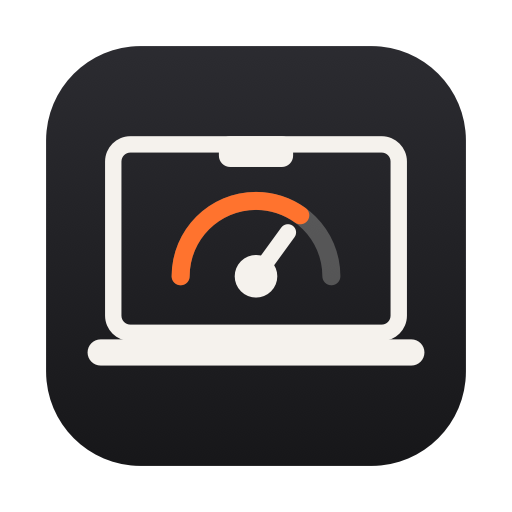
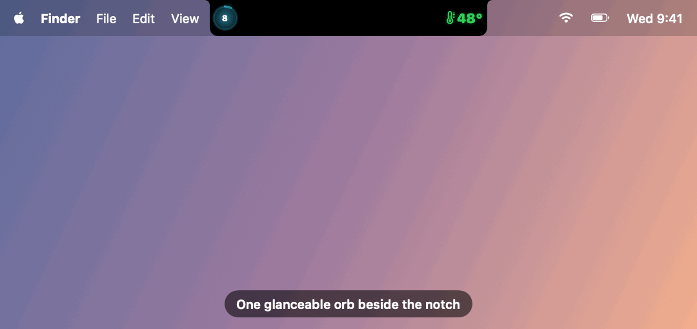

<p align="center"></p>

# Thermo

<p align="center">
  <b>Created by <a href="https://simarpreetsingh-019.github.io">Simarpreet Singh</a></b> ·
  <a href="https://x.com/simarpreet_019">@simarpreet_019</a> ·
  <a href="mailto:simarpreetsingh.019@gmail.com">simarpreetsingh.019@gmail.com</a><br>
  If Thermo helps you, please ⭐ star the repo and share it!
</p>

A tiny, live system monitor that lives **in your MacBook's notch**, or floats anywhere on any Mac.
It shows CPU, RAM, GPU and temperature, and when your Mac gets hot it tells you **what's slowing down, which app is causing it, how long cooling will take, and what to close**.

<p align="center"></p>
<p align="center">📖 <a href="https://simarpreetsingh-019.github.io/Thermo/"><b>Guide and docs</b></a> · 🎬 <a href="docs/launch.mp4"><b>Watch the full launch video (1080p, 32 s)</b></a></p>

- **Notch HUD:** glowing ring gauges beside the notch. Hover to expand, click 📌 to pin.
- **Pull it out:** drag the notch down and it becomes a floating widget. Drop it back at the top centre to re-dock.
- **Floating mode** for Macs without a notch: drag it anywhere, with magnetic edges, a corner snap, and a horizontal or vertical layout.
- **Menu bar mode**, if you prefer.
- **Memory tab:** shows real memory pressure and swap (not just "% used"), how much you could free, and the biggest apps with one-click quit. No fake "RAM cleaning".
- **Smart alerts:** a small card appears if your Mac stays hot, memory stays tight, or an app gets stuck at high CPU, with a one-click fix.
- **Health summary:** one line telling you if all is good, or what to close.
- **Heat tab:** heat level, separate temperatures for CPU performance and efficiency cores, GPU, memory, SSD, battery, Wi-Fi and palm rest (read from the SMC, no admin rights), what's affected (throttling, slower builds, dropped frames), the top culprit apps (including the project folder for `node`/`python` processes), a cooldown estimate, and one-click quit.
- **Apps tab:** top apps by CPU or memory, with quit buttons.
- **Battery tab** (MacBooks): health as a percentage of the original capacity, condition, cycle count against the rated 1000, charge rate or drain in watts, time left, and a 24-hour charge graph. Thermo logs health once a day, so you can see how it changes over time.
- **History tab:** CPU, memory, GPU and temperature graphs for the last hour or 24 hours, with a shared hover crosshair to see what happened at any moment.
- **No sudo, no kernel extensions, no dependencies.** It reads sensors through public and stable macOS APIs.

## Install

**Homebrew**
```bash
brew install --cask simarpreetsingh-019/thermo/thermo
```

Homebrew also adds the `thermo` command: `thermo status`, `thermo temps`, `thermo headroom`, `thermo help` and more (see [Use from Terminal](#use-from-terminal)).

**No Homebrew? Use the installer script.** It downloads the latest release, checks it, and installs it. Read it first, it's short:
```bash
curl -fsSL https://raw.githubusercontent.com/simarpreetsingh-019/Thermo/main/install.sh -o install.sh
```
```bash
bash install.sh
```
Before installing anything, it checks that the zip matches the release's SHA-256 checksum, that the GitHub attestation is valid (if you have the `gh` CLI), and that the app's signature and bundle ID are intact. If any check fails, nothing is installed.

**Direct download:** grab `Thermo.zip` from [Releases](https://github.com/simarpreetsingh-019/Thermo/releases), unzip it, and drag it into Applications. See [first launch](#first-launch-why-macos-warns-you) below.

**Build from source** (needs Xcode Command Line Tools):
```bash
git clone https://github.com/simarpreetsingh-019/Thermo && cd Thermo && ./build.sh --install
```
Add `--no-connect` to leave out the CLI JSON output, MCP server and local API (about 0.3 MB smaller).

Requires macOS 13+. It's a universal app (Apple Silicon and Intel), and Intel Macs read temperatures from the SMC (less tested there).

## First launch: why macOS warns you

If you downloaded the zip, macOS will say it **can't verify** that Thermo is free of malware. That's expected, and it's macOS doing its job: Apple only vouches for apps from developers in its paid program who send every build to Apple for scanning (notarization). Thermo is a free open-source side project and isn't notarized yet. The warning means "Apple hasn't checked this", not "this is harmful".

To open it once (macOS remembers your choice):
1. Double-click Thermo and click **Done** on the warning.
2. Open **System Settings → Privacy & Security**, scroll down, and click **Open Anyway** next to Thermo.
3. Confirm with your password or Touch ID.

On macOS 14 and earlier, right-click Thermo → **Open** also works. Homebrew and the installer script verify the download themselves, so they skip this step.

### Check your download yourself

You don't have to take our word for it:
- **Checksum:** compare the result with the SHA-256 in the release notes.
  ```bash
  shasum -a 256 ~/Downloads/Thermo.zip
  ```
- **Attestation:** GitHub signs a record of every release zip. This confirms the file was published by this repository and hasn't been swapped (needs the [GitHub CLI](https://cli.github.com)):
  ```bash
  gh attestation verify ~/Downloads/Thermo.zip --repo simarpreetsingh-019/Thermo
  ```
- **Source:** the full code is here; build it yourself with `./build.sh` if you prefer.

## Use from Terminal

Add `--json` to any reading for machine-readable output. Without Homebrew, use `/Applications/Thermo.app/Contents/MacOS/Thermo --cli <command>`.

| Command | What you get |
|---|---|
| `thermo status` | CPU, GPU, memory, heat, battery and a one-line health summary |
| `thermo temps` | temperature of each part |
| `thermo apps --sort memory` | busiest apps |
| `thermo battery` | health, cycles, charge, watts |
| `thermo history --range 24h` | averages and peaks |
| `thermo headroom --kind gpu --memory-gb 8` | room for a heavy job? exit 0 go, 3 wait, 4 no |
| `thermo wait-cool --target 70` | wait until the Mac cools |

```bash
thermo headroom --kind gpu --memory-gb 12 || thermo wait-cool --target 70
python train.py
```

## Connect AI agents and apps

Thermo includes an **MCP server**, so Claude, Codex, Cursor, VS Code and any MCP client can check your Mac before heavy work (training, builds, renders, local LLMs). Tools: `check_headroom`, `wait_until_cool`, `get_status`, `get_temperatures`, `get_top_processes`, `get_battery`, `get_history`.

```bash
claude mcp add thermo -- /Applications/Thermo.app/Contents/MacOS/Thermo --mcp
```

- **Claude Code plugin** (MCP server + skill): `/plugin marketplace add simarpreetsingh-019/Thermo`, then `/plugin install thermo@thermo`
- **Codex, Cursor, VS Code, Claude Desktop, others:** [integrations/](integrations/README.md)
- **Your own app:** one-file clients for [Python](clients/thermo_client.py), [JavaScript](clients/thermo.mjs) and [Swift](clients/Thermo.swift)
- **Local HTTP API:** opt-in (⚙ → Connections), `127.0.0.1:47615`, read-only, token-protected. [Endpoints](https://simarpreetsingh-019.github.io/Thermo/#api)
- **GitHub Actions:** `uses: simarpreetsingh-019/Thermo@v1` on macOS runners. [Details](integrations/README.md#github-actions)

## Roadmap

- **Windows and Linux support:** the CLI, API and MCP server first, then a tray app
- Apple notarization, so downloads open without a warning
- More agent integrations and MCP registry listings

## Updates

Thermo checks GitHub for a new version once a day. When one is out, an orange **Update** button appears in the panel: one click downloads it, verifies it and relaunches. You can also use ⚙ → **Check for Updates…**, or `brew upgrade --cask thermo` if you installed it with Homebrew.

## Feedback

I'd love to hear from you! Use ⚙ → **Send Feedback…** in the app (it fills in your version and Mac model), [open a feedback issue](https://github.com/simarpreetsingh-019/Thermo/issues/new/choose), DM me on [X](https://x.com/simarpreet_019), or email me (address in the Creator section below).

## How light is it?

Measured on an M5 MacBook:

| | Thermo |
|---|---|
| App size | **1.9 MB** |
| Memory (physical footprint) | **~16 MB** |
| CPU, notch collapsed | **~2.7% of one core**, about 0.3% of the whole chip |
| GPU | none beyond normal window drawing |
| Disk / network | writes only a few settings; one small update check per day |

How it stays light:
- It samples every 2 s, with timer tolerance so macOS can batch wake-ups.
- The full per-process scan runs only while the Apps or Heat list is open; otherwise it runs every 8 s.
- It's native Swift with no Electron, no web views and no helper daemons.

## How it works

| Metric | Source |
|---|---|
| CPU | `host_statistics` (Mach) |
| RAM | `host_statistics64` plus `vm.swapusage`, matching Activity Monitor's "Memory Used" |
| GPU | IORegistry `IOAccelerator` → `PerformanceStatistics` |
| Temperature | IOKit HID temperature sensors (Apple Silicon), no SMC access needed |
| Per-app usage | `proc_pid_rusage`; helper processes are grouped under their parent app |
| Throttling | `ProcessInfo.thermalState` |

## Creator

Thermo is designed and built by **Simarpreet Singh**.

- 🌐 Portfolio: [simarpreetsingh-019.github.io](https://simarpreetsingh-019.github.io)
- 🐦 X / Twitter: [@simarpreet_019](https://x.com/simarpreet_019)
- ✉️ Email: [simarpreetsingh.019@gmail.com](mailto:simarpreetsingh.019@gmail.com)
- 💻 GitHub: [@simarpreetsingh-019](https://github.com/simarpreetsingh-019)

Ideas, bugs or a feature you'd love? [Open an issue](https://github.com/simarpreetsingh-019/Thermo/issues), fork it, or send a pull request. Contributions are welcome!

## Credits and similar projects

Inspired by [Stats](https://github.com/exelban/stats), [Boring.Notch](https://github.com/TheBoredTeam/boring.notch), [Atoll](https://github.com/Ebullioscopic/Atoll) and [MacThrottle](https://github.com/angristan/MacThrottle).

## License

MIT

## Security

- **No telemetry, no admin rights.** Thermo reads local system statistics and saves its own preferences plus a 24-hour history file (about 60 KB, in `~/Library/Application Support/Thermo`). Its only network request is a daily update check against GitHub Releases, which sends nothing about you or your Mac. You can turn it off with ⚙ → "Check for updates automatically".
- **Updates are verified:** the downloaded zip must match the SHA-256 checksum published with the release, and the app inside must pass `codesign --verify` and carry Thermo's bundle ID before it replaces the installed copy.
- **Stopping processes:** apps are asked to quit normally, so they can prompt you to save. Background processes are stopped only after you confirm, and only if they belong to your user account. System-critical ones (loginwindow, Dock, WindowServer and others) are never offered. Each process is re-checked just before it's stopped, so a recycled process ID can't hit the wrong program.
- **Connections:** the CLI and MCP server open no network ports. The local API is off by default; when on, it listens only on 127.0.0.1, is read-only, needs a token stored in a file only you can read, and refuses requests from web pages and foreign host names. App names and project folders are shared with other tools only while ⚙ → Connections → "Share app names" is on.
- **Click-outside detection** watches only *that* a mouse click happened, never where or in which app, and never keystrokes. It needs no Accessibility permission.
- The app is ad-hoc signed with the hardened runtime. It isn't notarized yet; each release lists its SHA-256 checksum so you can verify the download.
